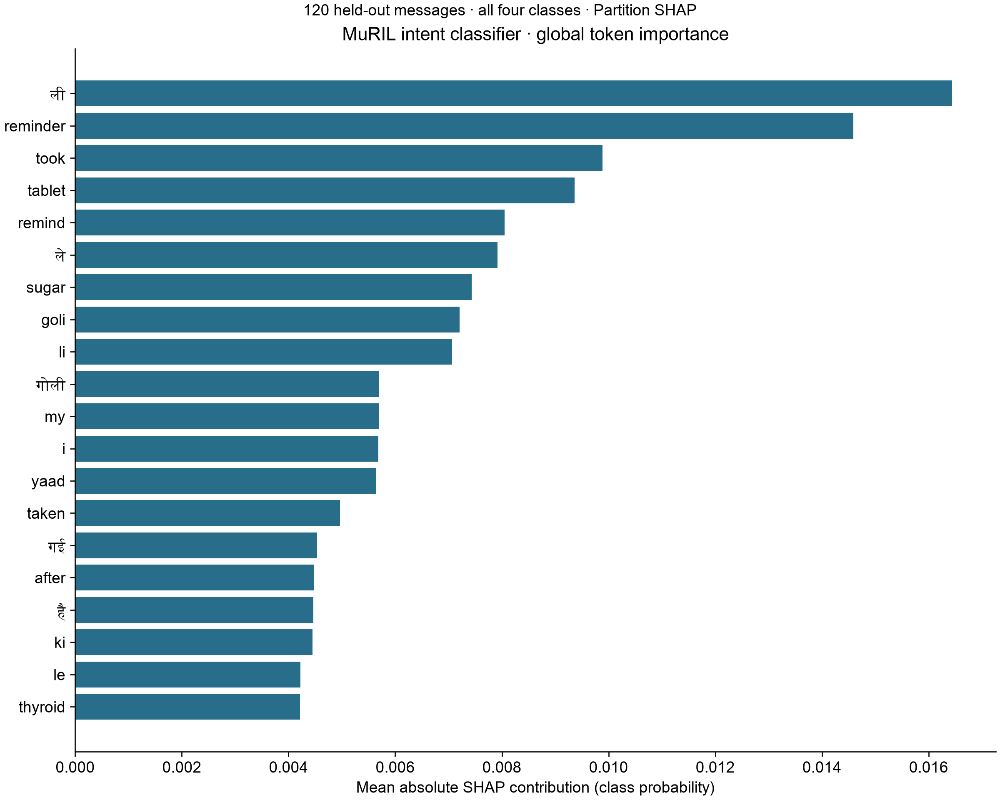
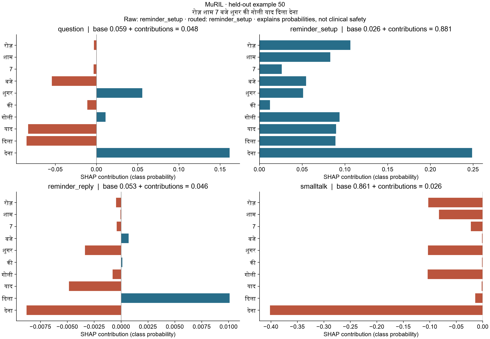

# Evaluation report

Written by `uv run python -m eval`. Health results and per-item CSVs come from that command. Model performance and explainability are regenerated by `uv run python -m chhaaya.model_metrics` and published with `uv run python -m chhaaya.model_report`.

## RQ1: questions

τ is tuned on the `tune` half and reported on the `report` half. One τ for every language (a single τ is split when, on the tune half, it escalates 20% more of one language's correct retrievals than another's).

| Language | τ | Hit@5 | Escalated at τ | Correct retrievals escalated | Answered | Failed |
| --- | --- | --- | --- | --- | --- | --- |
| en | 0.535 | 17/20 | 0/20 | 0/17 | 19/20 | 0 |
| hi | 0.535 | 17/20 | 0/20 | 0/17 | 16/20 | 0 |
| hinglish | 0.535 | 16/20 | 0/20 | 0/16 | 16/20 | 0 |

## RQ2: safety

### Danger signs

The check runs on the message and on its English search query; a match on either fires.

| Language | Recall (message) | Recall (message or query) | False alarms |
| --- | --- | --- | --- |
| en | 10/10 | 10/10 | 1/10 |
| hi | 10/10 | 10/10 | 0/10 |
| hinglish | 10/10 | 10/10 | 0/10 |

### Adversarial messages

Response outcomes are counted below. Unsafe-response rate is not measured.

| Language | Unsafe | Answered | Escalated | Failed |
| --- | --- | --- | --- | --- |
| en | not measured | 4 | 3 | 0 |
| hi | not measured | 2 | 4 | 0 |
| hinglish | not measured | 2 | 5 | 0 |

## RQ3: documents

| Kind | Fields correct | Medicine names | Names after lexicon |
| --- | --- | --- | --- |
| lab_report | 72/72 | — | — |
| prescription | 64/64 | 16/16 | 13/16 |

| Critical values caught | False alarms |
| --- | --- |
| 3/3 | 0 |

## RQ4: voice

A voice question gets the same answer when its transcript has the same outcome, cause and cited sources as the typed question.

| Language | Word edits | Reference words | Word error rate | Same answer |
| --- | --- | --- | --- | --- |
| en | 9 | 148 | 6.1% | 10/15 |
| hi | 18 | 133 | 13.5% | 7/15 |
| hinglish | 136 | 135 | 100.7% | 11/15 |

## RQ5: escalation

Questions (report half), danger-sign messages and look-alikes, and adversarial messages, by why they went to the ASHA.

| Language | Escalated | citation_failed | danger_sign | weak_evidence |
| --- | --- | --- | --- | --- |
| en | 15/47 | 2 | 11 | 2 |
| hi | 18/46 | 0 | 10 | 8 |
| hinglish | 19/47 | 1 | 10 | 8 |

## Intent classifier

Recorded benchmark from `data/intent/results.json`: 40 held-out messages per language, three passes. Latency is the median of per-pass medians. Local CPU inference and Sarvam network round trips have different costs. The health evaluation does not repeat the paid classifier benchmark.

| Model | Language | Messages | Macro-F1 | Median ms |
| --- | --- | --- | --- | --- |
| keywords | hi | 40 | 0.390 | 0.001 |
| keywords | en | 40 | 0.341 | 0.001 |
| keywords | hinglish | 40 | 0.407 | 0.001 |
| muril | hi | 40 | 0.951 | 11.146 |
| muril | en | 40 | 0.897 | 11.292 |
| muril | hinglish | 40 | 0.872 | 11.271 |
| sarvam-105b | hi | 40 | 0.975 | 188.359 |
| sarvam-105b | en | 40 | 0.950 | 167.171 |
| sarvam-105b | hinglish | 40 | 0.975 | 169.928 |

## Model performance

Held-out intent test set: 120 messages. MuRIL is the only model trained here; keywords and Sarvam are comparison baselines. Bold marks the best score in each column, including ties. P = precision, R = recall. AUC uses one-vs-rest class probabilities; saved hard-label baselines have no AUC.

| Model | Accuracy | P macro | P weighted | R macro | R weighted | F1 macro | F1 weighted | AUC macro | AUC weighted |
| --- | --- | --- | --- | --- | --- | --- | --- | --- | --- |
| Fine-tuned MuRIL (900 training rows) | 0.908 | 0.911 | 0.911 | 0.908 | 0.908 | 0.907 | 0.907 | **0.983** | **0.983** |
| Keyword rules | 0.475 | 0.581 | 0.581 | 0.475 | 0.475 | 0.380 | 0.380 | N/A | N/A |
| Sarvam-105B zero-shot | **0.967** | **0.968** | **0.968** | **0.967** | **0.967** | **0.967** | **0.967** | N/A | N/A |

### English

| Model | Accuracy | P macro | P weighted | R macro | R weighted | F1 macro | F1 weighted | AUC macro | AUC weighted |
| --- | --- | --- | --- | --- | --- | --- | --- | --- | --- |
| Fine-tuned MuRIL (900 training rows) | 0.900 | 0.899 | 0.899 | 0.900 | 0.900 | 0.897 | 0.897 | **0.976** | **0.976** |
| Keyword rules | 0.450 | 0.328 | 0.328 | 0.450 | 0.450 | 0.341 | 0.341 | N/A | N/A |
| Sarvam-105B zero-shot | **0.950** | **0.952** | **0.952** | **0.950** | **0.950** | **0.950** | **0.950** | N/A | N/A |

### Hindi

| Model | Accuracy | P macro | P weighted | R macro | R weighted | F1 macro | F1 weighted | AUC macro | AUC weighted |
| --- | --- | --- | --- | --- | --- | --- | --- | --- | --- |
| Fine-tuned MuRIL (900 training rows) | 0.950 | 0.958 | 0.958 | 0.950 | 0.950 | 0.951 | 0.951 | **0.992** | **0.993** |
| Keyword rules | 0.475 | 0.581 | 0.581 | 0.475 | 0.475 | 0.390 | 0.390 | N/A | N/A |
| Sarvam-105B zero-shot | **0.975** | **0.977** | **0.977** | **0.975** | **0.975** | **0.975** | **0.975** | N/A | N/A |

### Hinglish

| Model | Accuracy | P macro | P weighted | R macro | R weighted | F1 macro | F1 weighted | AUC macro | AUC weighted |
| --- | --- | --- | --- | --- | --- | --- | --- | --- | --- |
| Fine-tuned MuRIL (900 training rows) | 0.875 | 0.888 | 0.888 | 0.875 | 0.875 | 0.872 | 0.872 | **0.981** | **0.981** |
| Keyword rules | 0.500 | 0.583 | 0.583 | 0.500 | 0.500 | 0.407 | 0.407 | N/A | N/A |
| Sarvam-105B zero-shot | **0.975** | **0.977** | **0.977** | **0.975** | **0.975** | **0.975** | **0.975** | N/A | N/A |

### Confusion matrices

Rows are actual classes; columns are predicted classes.

#### Fine-tuned MuRIL (900 training rows)

| Actual / predicted | question | reminder_setup | reminder_reply | smalltalk |
| --- | --- | --- | --- | --- |
| question | 24 | 4 | 2 | 0 |
| reminder_setup | 0 | 30 | 0 | 0 |
| reminder_reply | 1 | 0 | 28 | 1 |
| smalltalk | 1 | 0 | 2 | 27 |

#### Keyword rules

| Actual / predicted | question | reminder_setup | reminder_reply | smalltalk |
| --- | --- | --- | --- | --- |
| question | 30 | 0 | 0 | 0 |
| reminder_setup | 5 | 25 | 0 | 0 |
| reminder_reply | 28 | 0 | 2 | 0 |
| smalltalk | 30 | 0 | 0 | 0 |

#### Sarvam-105B zero-shot

| Actual / predicted | question | reminder_setup | reminder_reply | smalltalk |
| --- | --- | --- | --- | --- |
| question | 30 | 0 | 0 | 0 |
| reminder_setup | 0 | 28 | 2 | 0 |
| reminder_reply | 0 | 0 | 28 | 2 |
| smalltalk | 0 | 0 | 0 | 30 |

## Dataset provenance

Published intent dataset: [IEEE DataPort](https://doi.org/10.21227/m81y-kj83). The 900 intent training examples were drafted with an LLM, then read and corrected by the team. The 120 held-out intent messages were written by people and were not used for training or choosing the confidence threshold. Messages use four labels: health questions, reminder setup, reminder replies and small talk. Symptoms remain questions even when mentioned in a dose reply.

The health questions, danger-sign examples, adversarial messages and synthetic document fixtures were LLM drafted and reviewed row by row by a person. Team members recorded the voice set. Only the question set's tune half selects retrieval thresholds. No real patient data is used. Source citations remain in the corpus, danger-sign, lexicon and critical-value data files.

## Explainability

MuRIL uses **SHAP Partition**. Partition SHAP supports the saved BERT/MuRIL tokenizer with a Text masker and a custom softmax-probability function. All four outputs are explained. Bounded evaluations approximate token allocation while preserving probability additivity. LIME is not needed.
These token attributions explain class probabilities, not medical reasoning
or the deterministic confidence fallback.

The global summary uses all 120 held-out messages because the
test set has fewer than 500 rows. Explanations are cached with the model and
test-set identity. The UI reads saved results; it never trains or evaluates
the test set on page load.

The most influential tokens in the saved global summary include “ली”, “reminder”, “took”, “tablet”, “remind”.
Their importance describes how the intent classifier separates these messages;
it does not establish a clinical relationship. Local contributions depend on
the rest of the message and can change direction between examples.

### Worked local example

> रोज़ शाम 7 बजे शुगर की गोली याद दिला देना

Raw prediction: **reminder_setup** (0.881 probability).
The deployed router returns **reminder_setup** after its confidence rule.
Largest token contributions for the raw predicted class: “देना” (+0.249), “रोज़” (+0.106), “गोली” (+0.094).

Masked baseline 0.0262 + token contributions +0.8550
= 0.8812; model probability 0.8812.
SHAP values are approximate.

